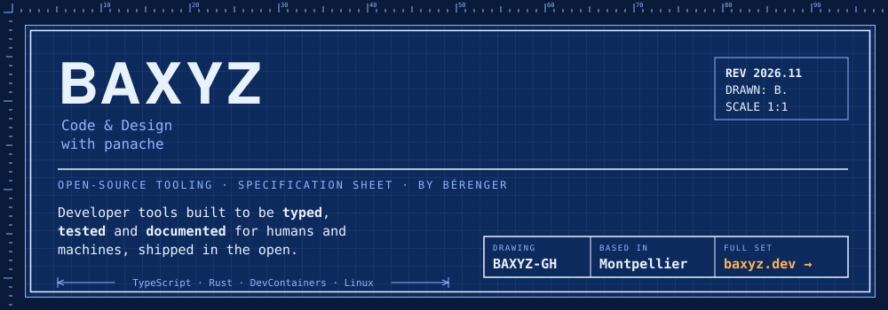
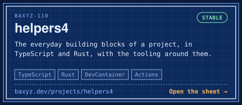
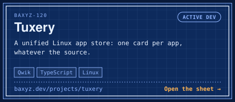
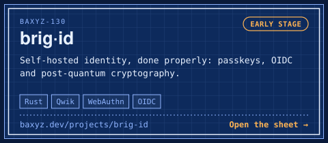
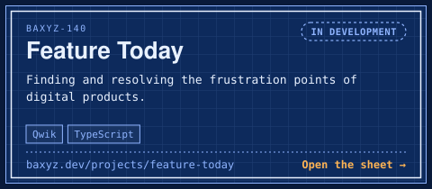
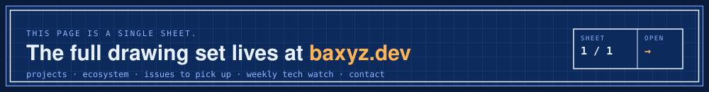

<a href="https://baxyz.dev">
  <picture>
    <source media="(prefers-color-scheme: dark)" srcset="assets/header-dark.svg">
    <source media="(prefers-color-scheme: light)" srcset="assets/header-light.svg">
    
  </picture>
</a>

### `1.0` Scope

I'm **Bérenger**, based in Montpellier. I build developer tools in the open: libraries in TypeScript and Rust,
DevContainer features, GitHub Actions, a Linux app store and a self-hosted identity stack. Some of it is mature, some of
it is just starting, and **I am looking for collaborators**.

→ The maker, the method and how to work together: **[baxyz.dev/about](https://baxyz.dev/about)**

### `2.0` Projects

The four projects where I am looking for collaborators. Each one has its own sheet on baxyz.dev, with what it needs most.

  <a href="https://baxyz.dev/projects/helpers4"><picture>
    <source media="(prefers-color-scheme: dark)" srcset="assets/card-helpers4-dark.svg">
    <source media="(prefers-color-scheme: light)" srcset="assets/card-helpers4-light.svg">
    
  </picture></a>
  <a href="https://baxyz.dev/projects/tuxery"><picture>
    <source media="(prefers-color-scheme: dark)" srcset="assets/card-tuxery-dark.svg">
    <source media="(prefers-color-scheme: light)" srcset="assets/card-tuxery-light.svg">
    
  </picture></a>
  <a href="https://baxyz.dev/projects/brig-id"><picture>
    <source media="(prefers-color-scheme: dark)" srcset="assets/card-brig-id-dark.svg">
    <source media="(prefers-color-scheme: light)" srcset="assets/card-brig-id-light.svg">
    
  </picture></a>
  <a href="https://baxyz.dev/projects/feature-today"><picture>
    <source media="(prefers-color-scheme: dark)" srcset="assets/card-feature-today-dark.svg">
    <source media="(prefers-color-scheme: light)" srcset="assets/card-feature-today-light.svg">
    
  </picture></a>

### `3.0` Ecosystem

Smaller contributions, from GNOME Shell extensions to Firefox add-ons and zero-dependency npm libraries.

| Item | What it does | Where |
| --- | --- | --- |
| [Firefox Profiles](https://extensions.gnome.org/extension/7236/firefox-profiles/) | Launch Firefox with the profile you want from the GNOME indicator menu | [`gnome-extensions`](https://github.com/baxyz/gnome-extensions) |
| [Quick Exit](https://extensions.gnome.org/extension/10744/quick-exit/) | Cuts GNOME's log-out / power-off countdown down to one second | [`gnome-extensions`](https://github.com/baxyz/gnome-extensions) |
| [mozlz4](https://www.npmjs.com/package/mozlz4) | Encode and decode the LZ4 format of Firefox and Zen session files | [`mozlz4`](https://github.com/baxyz/mozlz4) |
| [sqlite-reader](https://www.npmjs.com/package/sqlite-reader) | Read a SQLite3 database file without a SQL engine | [`sqlite-reader`](https://github.com/baxyz/sqlite-reader) |
| [Close Bookmarked Tabs](https://addons.mozilla.org/en/firefox/addon/close-bookmarked-tabs/) | Closes, in one click, the open tabs you have already bookmarked | [`close-bookmarked-tabs`](https://github.com/baxyz/close-bookmarked-tabs) |

→ The full list, with status and licences: **[baxyz.dev/ecosystem](https://baxyz.dev/ecosystem)**

### `4.0` Quality gates

Typed and tested · mutation testing · zero-dependency libraries · `unsafe` forbidden in Rust · Conventional Commits ·
OpenSSF Scorecard · `llms.txt` and `AGENTS.md` for agents · reproducible DevContainers.
The evidence for each one is public: **[baxyz.dev/#quality](https://baxyz.dev/#quality)**

### `5.0` Pick something up

Open issues labelled *good first issue* or *help wanted*, across every organisation, gathered on one page:
**[baxyz.dev/contribute](https://baxyz.dev/contribute)**

### `6.0` Field notes and contact

[Tech Watch](https://notes.baxyz.dev/t/tech-watch) (weekly) ·
[helpers4 blog](https://helpers4.dev/blog) ·
[Mastodon](https://c.im/@baxyz) ·
[W](https://wsocial.eu/profile/baxyz.wsocial.eu) ·
[Matrix](https://matrix.to/#/@baxyz:beeper.com) ·
[GitLab](https://gitlab.com/baxyz/) ·
e-mail on [baxyz.dev/#contact](https://baxyz.dev/#contact)

Organisations: [helpers4](https://github.com/helpers4) · [tuxery](https://github.com/tuxery) ·
[brig-id](https://github.com/brig-id) · [feature-today](https://github.com/feature-today)

<a href="https://baxyz.dev">
  <picture>
    <source media="(prefers-color-scheme: dark)" srcset="assets/footer-dark.svg">
    <source media="(prefers-color-scheme: light)" srcset="assets/footer-light.svg">
    
  </picture>
</a>
